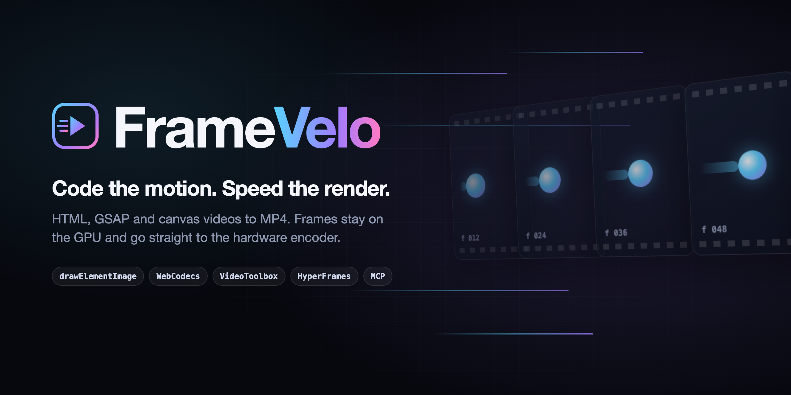
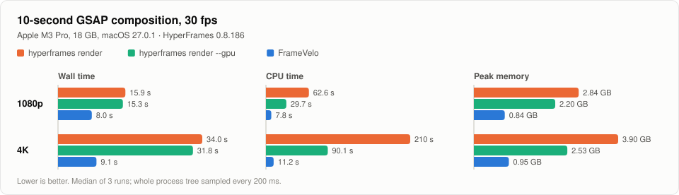
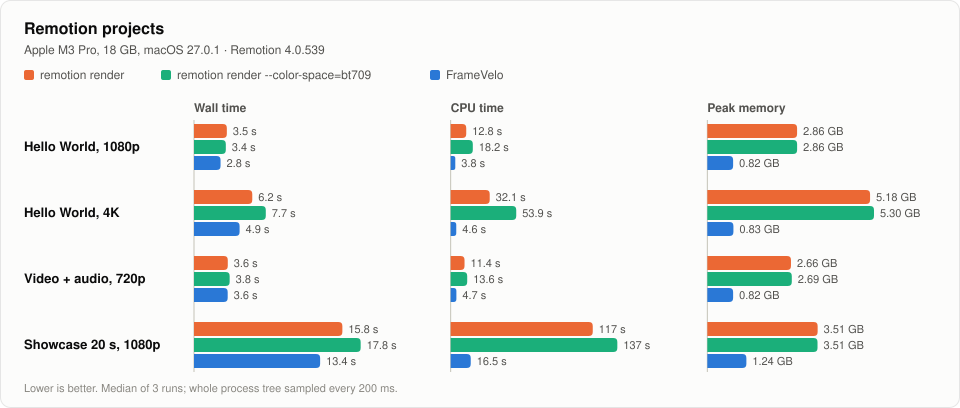

<p align="center">
  
</p>

<p align="center">
  <a href="https://github.com/gnipbao/framevelo/actions/workflows/ci.yml"></a>
  <a href="LICENSE"></a>
  
  
  <a href="#接入-ai-agent"></a>
</p>

<p align="center"><a href="README.md">English</a> · <b>简体中文</b> · <a href="README.ja.md">日本語</a></p>

**FrameVelo**：为代码生成的视频，加速每一帧。它把 [HyperFrames](https://github.com/heygen-com/hyperframes) 项目、[Remotion](https://www.remotion.dev) 项目，以及任何按时间纯函数绘制的 HTML/CSS/GSAP 或 Canvas/WebGL 页面渲染成 MP4，在硬件允许的范围内把耗时、CPU 和内存压到最低。

大多数代码视频渲染器的做法是：每帧截图 → base64 传回 Node → FFmpeg 再解码 → CPU 上转 YUV → x264 编码。FrameVelo 让帧一直留在 GPU 上：

```
seek(t) ─► drawElementImage（DOM）/ canvas ─► VideoFrame ─► WebCodecs VideoEncoder（硬件编码）
        ─► H.264 / HEVC ─► 直接封装 + 音轨 ─► 校验后的 MP4
```

## 亮点

- 渲染一段 10 秒的 GSAP 合成，**4K 比 `hyperframes render` 快 3.8 倍，1080p 快 2.0 倍**；4K 下 CPU 时间只有官方的 1/19，峰值内存少 76%。
- **画面一致。**在 24 个 HyperFrames 官方回归用例上，23 个与官方渲染的 PSNR 在 40 dB 以上；合计快 1.6 倍，CPU 时间为官方的 1/2.1，峰值内存少 49%。
- **HyperFrames 走官方管线。**字体、子合成、片段窗口、`<video>` 帧、着色器转场和混音都来自 `@hyperframes/producer`，FrameVelo 只替换采集和编码。
- **也支持 Remotion 项目。**同样的项目，和 `remotion render` 相比，FrameVelo 的 CPU 时间少 2.6–7 倍、峰值内存少 69–84%，耗时基本持平（0.9–1.3 倍）：Remotion 用多个标签页并行截 JPEG、把 CPU 跑满，FrameVelo 把 CPU 留给别的事。打包、`<OffthreadVideo>` 帧和混音仍由 Remotion 自己完成，音频逐采样一致。
- **结果可靠。**编码前逐区间与原生截图比对，不一致的区间自动改用截图；输出用 ffprobe 校验后原子写入。
- **为 Agent 准备好。**MCP 服务（`framevelo mcp`）、Claude Code 插件与 skill，以及给只能用 shell 的 Agent 的 `--json` 输出。

<picture>
  <source media="(prefers-color-scheme: dark)" srcset="docs/assets/bench-gsap-dark.svg">
  
</picture>

测试环境：Apple M3 Pro（11 核，18 GB），macOS 27.0.1，chrome-headless-shell 154，HyperFrames 0.8.186，取 3 次的中位数。完整表格、逐用例图表和测试方法：[docs/benchmarks.md](docs/benchmarks.md)。

## 快速上手

```bash
npm install -g github:gnipbao/framevelo @hyperframes/producer@0.8 @hyperframes/engine@0.8
```

```bash
framevelo browser install
```

```bash
framevelo render my-hyperframes-project/ -o film.mp4
```

FrameVelo 还没发布到 npm，先从 GitHub 安装；HyperFrames 包只在渲染 HyperFrames 项目时需要。`framevelo browser install` 会下载 `chrome-headless-shell`，CPU 和内存约为完整版 Chrome 的一半。`framevelo doctor` 检查本机环境：浏览器、`drawElementImage`、硬件编码器、FFmpeg 和 HyperFrames。

更多示例（输入是 `.html` 文件，或包含 `index.html` 的目录）：

```bash
framevelo render examples/dom-cards -o dom-cards.mp4 --scale 2
```

```bash
framevelo render examples/canvas-particles -o particles.mp4 --codec hevc --subframes 3
```

**环境要求：**macOS 或 Windows、Node.js 22.18+、`PATH` 中有 FFmpeg 和 FFprobe、Chrome 151+（优先 `chrome-headless-shell`）。上面的性能数据都在 Apple 芯片的 macOS 上测得。Windows 在 CI 中跑同样的集成测试：显卡带编码器时用硬件编码 H.264，否则用 Chrome 的软件编码器；HEVC 需要硬件编码器。Linux 只跑单元测试。Remotion 项目需要先装好项目自己的依赖（`npm install`）。

## 能渲染什么

### HyperFrames 项目

根节点带 `data-composition-id` 的页面交给官方 HyperFrames 管线编译和提供服务，渲染结果与 `hyperframes render` 一致。加 `--no-hyperframes` 可按普通页面渲染。

### Remotion 项目

把 FrameVelo 指向一个 Remotion 项目（项目目录或入口文件），并指定合成：

```bash
framevelo render my-remotion-project/ --composition MyComp -o out.mp4 --props '{"title":"Hello"}'
```

Remotion 相关的部分都交给项目自己的 Remotion：它的 CLI 打包项目（`remotion.config.ts` 照常生效），它的渲染器提供打包结果和 `<OffthreadVideo>` 的视频帧，它的混音器根据每帧播放的内容生成音频。FrameVelo 挂载合成（含 `calculateMetadata()` 和解析后的 props），逐帧驱动，只替换采集和编码。项目需要先装好依赖；支持 Remotion 4（测试版本 4.0.539）。Remotion 按整帧渲染，所以 `--subframes` 不起作用，运动模糊请在合成里用 `<CameraMotionBlur>`。项目本身照常遵守 Remotion 的许可证。

<picture>
  <source media="(prefers-color-scheme: dark)" srcset="docs/assets/bench-remotion-dark.svg">
  
</picture>

### 任何可 seek 的页面

每一帧都必须是时间的纯函数。FrameVelo 按以下顺序查找时间驱动：

1. `window.__framevelo = { seek(t), duration, fps, audio }`（`seek` 可以返回 Promise；`audio` 是要封装的配乐地址）
2. `window.__seek(t)`，可选 `window.__duration`
3. 注册在 `window.__timelines.main`（或第一个键）上的暂停 GSAP 时间线

```html
<canvas id="scene" width="1920" height="1080"></canvas>
<script>
  const g = document.getElementById("scene").getContext("2d");
  function draw(t) {
    g.fillStyle = "#05060a";
    g.fillRect(0, 0, 1920, 1080);
    g.fillStyle = "#6cf";
    g.fillRect(200 + 300 * t, 500, 120, 120);
  }
  window.__framevelo = { duration: 4, seek: draw };
</script>
```

视频素材用 `<video data-start="0.5">` 放到合成时间轴上（可选 `data-media-start`、`data-duration`、`data-playback-rate`）：FrameVelo 逐帧精确定位；关键帧间隔长的源会生成缓存的全帧内代理，每次定位只解码一帧。`Math.random` 使用固定种子，渲染可复现。依赖 `requestAnimationFrame` 循环、CSS transition 或真实时钟的页面无法 seek。上面的[封面](docs/assets/cover.html)就是这样一个页面：`framevelo render docs/assets/cover.html` 会把它渲染成 4 秒的短片。

## 接入 AI Agent

`framevelo mcp` 是一个 MCP 服务，提供三个工具：`render`、`doctor` 和 `install_browser`。配套的 [skill](plugin/skills/framevelo/SKILL.md) 教 Agent 完整流程：先预览一小段、再完整渲染、检查结果、按错误类型处理失败。

**Claude Code**：插件同时包含服务和 skill。

```
/plugin marketplace add gnipbao/framevelo
/plugin install framevelo@framevelo
```

本机装了 `framevelo` 时直接使用；否则首次启动会把 FrameVelo 安装到 `~/.cache/framevelo`（约一分钟，之后启动不到一秒）。如果 Claude Code 在安装期间等不及，装完后用 `/mcp` 重新连接即可。

**Codex、Cursor、Claude Desktop 等 MCP 客户端**：先按「快速上手」安装一次，再注册服务：

```json
{ "mcpServers": { "framevelo": { "command": "framevelo", "args": ["mcp"] } } }
```

```toml
# ~/.codex/config.toml
[mcp_servers.framevelo]
command = "framevelo"
args = ["mcp"]
```

`render` 接收与命令行相同的参数，写成 JSON（`input`、`output`、`frames`、`start`、`quality`、`scale`，Remotion 项目还有 `composition` 和 `props` 等）；渲染中发送进度通知，可以取消，一次只跑一个任务，返回输出路径、帧数、尺寸、耗时和警告。**只能用 shell 的 Agent：**`framevelo render <input> -o out.mp4 --json -q` 输出 JSON 结果；失败时输出 `{"error": "..."}` 并以 1 退出。

## 工作原理

- **Canvas 页面**：`<canvas>` 本身就是画面。
- **DOM 页面**：被采集的元素移进 `<canvas layoutsubtree>`，用 `drawElementImage` 绘制。画布后备尺寸等于输出尺寸，`--scale 2` 会把 1080p 布局按 4K 重新光栅化。
- **自校验**：编码前，每个区间（按片段边界切分）的采样帧分别用两种方式绘制并与原生截图比对；低于 `--verify-threshold`（30 dB）的区间改用截图采集，仍走同一个编码器。
- **静帧复用**：画面没有可见变化的帧复用上一帧绘制，开启与关闭的输出逐字节一致。
- **多页面并行**：需要 Node 逐帧驱动的帧（HyperFrames 视频帧、截图区间）受往返延迟限制，较长的这类帧段会分给多个页面，各用自己的编码器，最后按顺序拼接再封装。
- **输出**：WebCodecs 用硬件编码器编码；FFmpeg 只把码流和音轨封装进 MP4 并写入 BT.709 标记。先写临时文件，用 ffprobe 校验后再重命名，失败不留半成品。

设计说明，以及实测后放弃的方案：[docs/architecture.md](docs/architecture.md)。

## 命令行

```
framevelo render <input> [options]
framevelo doctor
framevelo browser install [version] | framevelo browser path
framevelo mcp
```

| 选项 | 默认值 | 说明 |
|---|---|---|
| `-o, --output <file>` | `<输入名>.mp4` | 输出 MP4 |
| `--fps <n>` | 页面帧率，否则 30 | 帧率；支持整数和 NTSC 帧率（29.97、59.94） |
| `--duration <s>`、`--frames <n>` | 页面时长 | 渲染长度 |
| `--start <s>` | 0 | 起始时间；音轨同步偏移 |
| `--width`、`--height <px>`、`--scale <n>` | 采集尺寸 | 输出尺寸 |
| `--viewport <WxH>` | 取自页面，否则 1920x1080 | CSS 视口 |
| `--mode <m>` | `auto` | `auto`、`canvas` 或 `dom` |
| `--selector <css>` | | 要采集的元素或 canvas |
| `--capture <c>` | `auto` | DOM 页面：`auto`（校验并按区间回退）、`dom`、`screenshot` |
| `--verify-threshold <dB>` | 30 | 区间改用截图的校验阈值 |
| `--codec <c>` | `h264` | `h264` 或 `hevc` |
| `--quality <q>` | `standard` | `draft`、`standard`（约等于 x264 CRF 18）、`high` |
| `--bitrate <b>` | 由尺寸、帧率和画质推算 | 目标码率，例如 `12M` |
| `--audio <file>` | 合成自带音轨 | 音轨 |
| `--subframes <n>`、`--shutter <f>` | 1、0.5 | 在 GPU 上平均子帧实现运动模糊 |
| `--background <css>` | 页面背景 | DOM 透明区域后面的颜色 |
| `--mount <prefix>=<dir>` | | 额外提供一个目录，例如 `/vendor/=./vendor` |
| `--workers <n>` | 按 CPU 核数 | Node 驱动帧最多使用的页面数；`1` 关闭多页面并行 |
| `--no-hyperframes` | | 把 HyperFrames 项目当普通页面渲染 |
| `--composition <id>` | 唯一的那个 | Remotion 项目：要渲染的合成 |
| `--props <json\|file>` | 默认 props | Remotion 项目：输入 props，内联 JSON 或 `.json` 文件 |
| `--no-paint-reuse` | | 每帧都重新绘制 |
| `--no-video-proxy` | | 不生成视频代理，直接定位源文件 |
| `--chrome <path>` | 先 headless shell，再 Chrome | 浏览器可执行文件 |
| `--json`、`-q, --quiet` | | 以 JSON 输出结果；不显示进度 |

## API

```js
import { render } from "framevelo";

const result = await render({ input: "examples/dom-cards", output: "dom-cards.mp4", scale: 2 });
console.log(result.wallMs, result.stages, result.warnings);
```

`onProgress(done, total)` 报告帧进度；传入 `signal`（`AbortSignal`）可以中止渲染，不留下文件。

## 已知限制

- `drawElementImage` 是 Origin Trial API（到 Chrome 160），并在 Chrome 155 改过形态。自校验能挡住回归；升级 Chrome 后建议用 `node bench/parity.ts` 复核。
- 视频为主的 HyperFrames 项目提速不如动效项目明显：每个新视频帧要多付一次渲染更新，多页面并行可以把这些等待重叠起来，代价是更多内存。
- Remotion 支持依赖 Remotion 4 的渲染页协议，这是 Remotion 的内部接口：遇到不同版本协议的打包结果会给出明确的错误，而不是渲染出错误的画面。每个 `<OffthreadVideo>` 帧仍要从 Remotion 的帧服务器取一次。
- 硬件编码器与其他应用共享，录屏或视频会议会让编码变慢；同等画质下它比 x264 需要更高码率，所以文件更大。

## 开发

```bash
npm install
npm test
npm run test:integration
```

`npm test` 运行单元测试和 MCP 协议测试；`npm run test:integration` 通过 Chrome 和 FFmpeg 渲染示例。`node bench/run.ts` 和 `node bench/report.ts` 复现基准测试（[bench/README.md](bench/README.md)）。源码直接运行在 Node 的 TypeScript 类型剥离上；`npm run build` 生成 `dist/`。编码 Agent 请看 [AGENTS.md](AGENTS.md)。最初的可行性调研报告见 [docs/research-render-acceleration.md](docs/research-render-acceleration.md)。

## 许可证

[Apache-2.0](LICENSE)。部分代码移植自 HyperFrames，见 [NOTICE](NOTICE)。
