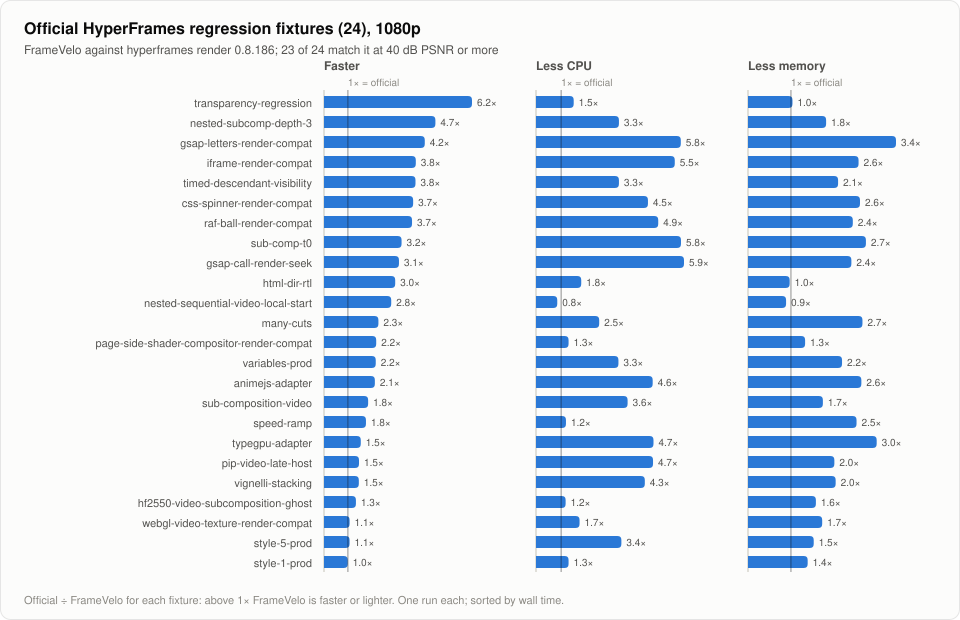

# Benchmarks

FrameVelo against the official `hyperframes render` 0.8.186 and `remotion render` 4.0.539 on one machine. Generated by `node bench/report.ts` from the results in [`bench/results`](../bench/results); rerun with `node bench/run.ts` (see [bench/README.md](../bench/README.md)).

| | |
|---|---|
| Machine | Apple M3 Pro (Mac15,6), 11 cores, 18 GB |
| System | macOS 27.0.1, Node v22.23.2 |
| Browser | chrome-headless-shell 154.0.8037.57 |
| FFmpeg | 7.0.2 |

| Suites | Run | FrameVelo | Load average (1 minute, before → after) |
|---|---|---|---|
| gsap, fixtures, workers, browser | [2026-10-24](../bench/results/2026-10-24-m3pro.json) | 0.4.0 (c055ded) | 3.9 → 6.2 |
| remotion | [2026-10-31](../bench/results/2026-10-31-m3pro-remotion.json) | 0.5.0 (f65ddd1) | 2.7 → 8.7 |

**Method.** Each render runs alone. Wall time, CPU time (user + system) and peak resident memory cover the whole process tree (Node, Chrome and its helpers, FFmpeg), sampled every 200 ms. Quality is per-frame PSNR of the FrameVelo output against the official output. The machine is a working desktop rather than a lab box (see the load average above), so expect a few percent of noise.

## GSAP composition

[`bench/fixtures/gsap-showcase`](../bench/fixtures/gsap-showcase): 10 seconds at 30 fps of 80 cards with rounded corners, gradients and blurred shadows, three large radial gradients and per-letter title animation, all driven by one paused GSAP timeline. Rendered at 1080p and at 4K (`--resolution 4k` for the official CLI, `--scale 2` for FrameVelo). Median of 3 interleaved runs.

<picture>
  <source media="(prefers-color-scheme: dark)" srcset="assets/bench-gsap-dark.svg">
  
</picture>

| Resolution | Renderer | Wall | CPU | Peak memory | File | PSNR vs official |
|---|---|---:|---:|---:|---:|---:|
| 1080p | `hyperframes render` | 15.9 s | 62.6 s | 2904 MB | 14.3 MB | reference |
| 1080p | `hyperframes render --gpu` | 15.3 s | 29.7 s | 2254 MB | 12.7 MB | 45.2 dB |
| 1080p | **FrameVelo** | 8.0 s | 7.8 s | 856 MB | 15.5 MB | 45.9 dB |
| 4K | `hyperframes render` | 34.0 s | 210.2 s | 3998 MB | 37 MB | reference |
| 4K | `hyperframes render --gpu` | 31.8 s | 90.1 s | 2589 MB | 12.7 MB | 43.9 dB |
| 4K | **FrameVelo** | 9.1 s | 11.2 s | 969 MB | 56 MB | 48.8 dB |

FrameVelo's files are larger at the same quality: the hardware encoder needs more bits than x264, and FrameVelo's default bitrate targets about x264 CRF 18. `--gpu` makes the official CLI encode on VideoToolbox at a lower bitrate, which costs it quality (the PSNR column).

## Official regression fixtures

The 24 projects of [`packages/producer/tests`](https://github.com/heygen-com/hyperframes/tree/v0.8.186/packages/producer/tests) in the HyperFrames repository that render on macOS without extra services, at 1080p, one run each. 24 of 24 render with both tools, and 23 of them match the official output at 40 dB PSNR or more (`page-side-shader-compositor-render-compat` 37.5 dB).

**Totals:** wall time 409.0 s → 256.6 s (1.59× faster), CPU 625.8 s → 298.4 s (2.10× less), mean peak memory 1852 MB → 938 MB (49% less). FrameVelo is slower on `style-1-prod`.

<picture>
  <source media="(prefers-color-scheme: dark)" srcset="assets/bench-fixtures-dark.svg">
  
</picture>

| Fixture | Frames | PSNR avg / min | Wall official → FrameVelo | CPU official → FrameVelo | Peak memory official → FrameVelo |
|---|---:|---:|---:|---:|---:|
| nested-subcomp-depth-3 | 60 | 49.7 / 49.3 dB | 12.0 → 2.6 s | 6.6 → 2.0 s | 1304 → 717 MB |
| css-spinner-render-compat | 150 | 55.7 / 54.9 dB | 6.9 → 1.8 s | 9.8 → 2.2 s | 1893 → 726 MB |
| raf-ball-render-compat | 150 | 62 / 60 dB | 6.6 → 1.8 s | 10.7 → 2.2 s | 1857 → 761 MB |
| gsap-letters-render-compat | 120 | 66.4 / 57.6 dB | 10.8 → 2.6 s | 12.1 → 2.1 s | 2319 → 673 MB |
| many-cuts | 168 | 60.4 / 51.4 dB | 22.7 → 10.0 s | 17.1 → 6.8 s | 2369 → 889 MB |
| speed-ramp | 120 | 47.6 / 44.9 dB | 8.2 → 4.7 s | 6.2 → 5.2 s | 1865 → 738 MB |
| animejs-adapter | 180 | 49.7 / 39.5 dB | 11.2 → 5.3 s | 13.0 → 2.8 s | 1924 → 729 MB |
| html-dir-rtl | 60 | 48.5 / 46.4 dB | 8.1 → 2.7 s | 3.6 → 2.0 s | 744 → 767 MB |
| transparency-regression | 30 | 55.1 / 54.9 dB | 5.9 → 0.9 s | 2.1 → 1.4 s | 674 → 651 MB |
| style-1-prod | 510 | 50.7 / 48.1 dB | 32.5 → 32.8 s | 59.1 → 45.6 s | 2527 → 1819 MB |
| style-5-prod | 572 | 50.8 / 46.9 dB | 34.2 → 32.0 s | 72.7 → 21.4 s | 2647 → 1730 MB |
| sub-composition-video | 390 | 49.3 / 48.4 dB | 45.1 → 24.4 s | 83.1 → 22.8 s | 2636 → 1512 MB |
| typegpu-adapter | 180 | 52.9 / 51.1 dB | 10.9 → 7.1 s | 18.7 → 4.0 s | 2262 → 755 MB |
| webgl-video-texture-render-compat | 60 | 45.8 / 42.3 dB | 51.8 → 48.4 s | 7.8 → 4.5 s | 1204 → 697 MB |
| iframe-render-compat | 150 | 61.4 / 56.1 dB | 7.4 → 1.9 s | 12.7 → 2.3 s | 1838 → 714 MB |
| pip-video-late-host | 180 | 51.7 / 47.7 dB | 17.5 → 12.0 s | 31.2 → 6.7 s | 2244 → 1116 MB |
| variables-prod | 90 | 62.2 / 53.1 dB | 8.3 → 3.8 s | 8.2 → 2.5 s | 1537 → 702 MB |
| hf2550-video-subcomposition-ghost | 1516 | 50.9 / 46 dB | 41.9 → 31.4 s | 157.6 → 133.7 s | 2760 → 1746 MB |
| nested-sequential-video-local-start | 60 | 100 / 100 dB | 7.9 → 2.8 s | 4.4 → 5.2 s | 633 → 714 MB |
| timed-descendant-visibility | 270 | 53.6 / 41.7 dB | 7.3 → 1.9 s | 6.6 → 2.0 s | 1527 → 728 MB |
| vignelli-stacking | 308 | 52.2 / 48.5 dB | 21.3 → 14.6 s | 44.6 → 10.3 s | 2394 → 1173 MB |
| page-side-shader-compositor-render-compat | 60 | 37.5 / 27.2 dB | 10.6 → 4.8 s | 7.0 → 5.4 s | 1081 → 813 MB |
| gsap-call-render-seek | 180 | 53.1 / 49.3 dB | 9.0 → 2.9 s | 15.9 → 2.7 s | 1964 → 816 MB |
| sub-comp-t0 | 180 | 58.4 / 47.6 dB | 10.8 → 3.3 s | 15.0 → 2.6 s | 2243 → 817 MB |

Motion graphics gain the most. Video-heavy fixtures gain less: their frames come from the official extraction and injector, which costs about one rendering update per new video frame.

## Parallel pages

`hf2550-video-subcomposition-ghost` (1516 frames, most of them with an injected video frame) rendered with `--workers 1` to `4`. Frames driven from Node are latency-bound, so extra pages overlap their round trips.

| `--workers` | Pages | Render stage | Wall | CPU | Peak memory | PSNR vs official |
|---:|---:|---:|---:|---:|---:|---:|
| 1 | 1 | 39.2 s | 53.0 s | 119.9 s | 1287 MB | 51 / 46.1 dB |
| 2 | 2 | 22.1 s | 34.9 s | 122.4 s | 1570 MB | 51 / 46.1 dB |
| 3 | 3 | 16.3 s | 28.0 s | 124.8 s | 2020 MB | 50.9 / 46 dB |
| 4 | 4 | 14.6 s | 25.8 s | 132.7 s | 2040 MB | 50.8 / 46.1 dB |

## Browser

FrameVelo on the GSAP composition at 1080p with each browser. Median of 3 runs.

| Browser | Wall | CPU | Peak memory |
|---|---:|---:|---:|
| chrome-headless-shell | 7.5 s | 7.6 s | 841 MB |
| chrome | 7.9 s | 10.5 s | 1472 MB |

`chrome-headless-shell` skips the browser UI and its helper processes; `framevelo browser install` installs it and FrameVelo prefers it.

## Remotion

`remotion render` 4.0.539 against FrameVelo on the same projects: Remotion's own hello-world template (`npx create-video --hello-world`, the `HelloWorld` composition, 5 s) at 1080p and at 4K (`--scale 2` for both), and [`test/fixtures/remotion`](../test/fixtures/remotion) at 720p, 3 s with an `<OffthreadVideo>` and an `<Audio>` with a volume curve. Both bundle the project with Remotion's CLI and mix the audio with Remotion's mixer; FrameVelo captures with `drawElementImage` and encodes on the hardware encoder where `remotion render` takes JPEG screenshots in several tabs and encodes with x264. Median of 3 interleaved runs.

<picture>
  <source media="(prefers-color-scheme: dark)" srcset="assets/bench-remotion-dark.svg">
  
</picture>

| Project | Renderer | Wall | CPU | Peak memory | File | PSNR vs remotion render |
|---|---|---:|---:|---:|---:|---:|
| Hello World, 1080p | `remotion render` | 3.0 s | 11.6 s | 2933 MB | 0.6 MB | reference |
| Hello World, 1080p | **FrameVelo** | 2.7 s | 3.9 s | 849 MB | 1.8 MB | 43.3 / 43 dB |
| Hello World, 4K | `remotion render` | 6.1 s | 29.6 s | 5401 MB | 1.3 MB | reference |
| Hello World, 4K | **FrameVelo** | 4.7 s | 4.6 s | 849 MB | 3.7 MB | 40.6 / 35.3 dB |
| Video + audio, 720p | `remotion render` | 3.2 s | 11.7 s | 2750 MB | 0.6 MB | reference |
| Video + audio, 720p | **FrameVelo** | 3.5 s | 4.5 s | 847 MB | 0.7 MB | 43.4 / 42.2 dB |
| Showcase 20 s, 1080p | `remotion render` | 14.4 s | 113.9 s | 4184 MB | 13 MB | reference |
| Showcase 20 s, 1080p | **FrameVelo** | 12.9 s | 16.2 s | 1313 MB | 31.8 MB | 41.5 / 40.7 dB |

- Hello World, 1080p: 1.1× faster, 3.0× less CPU, 71% less peak memory.
- Hello World, 4K: 1.3× faster, 6.4× less CPU, 84% less peak memory.
- Video + audio, 720p: 0.9× faster, 2.6× less CPU, 69% less peak memory.
- Showcase 20 s, 1080p: 1.1× faster, 7.0× less CPU, 69% less peak memory.
